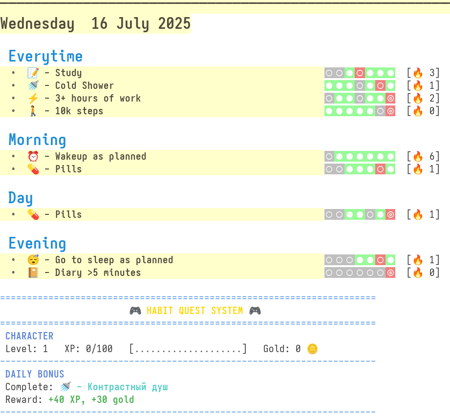
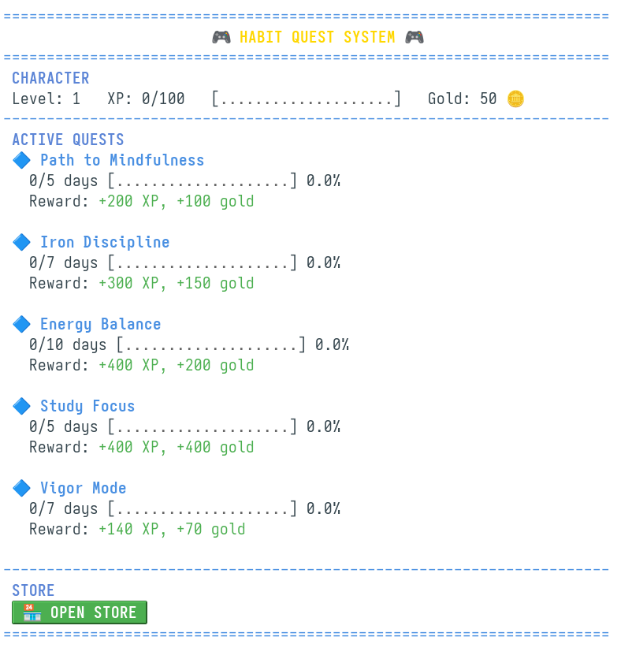
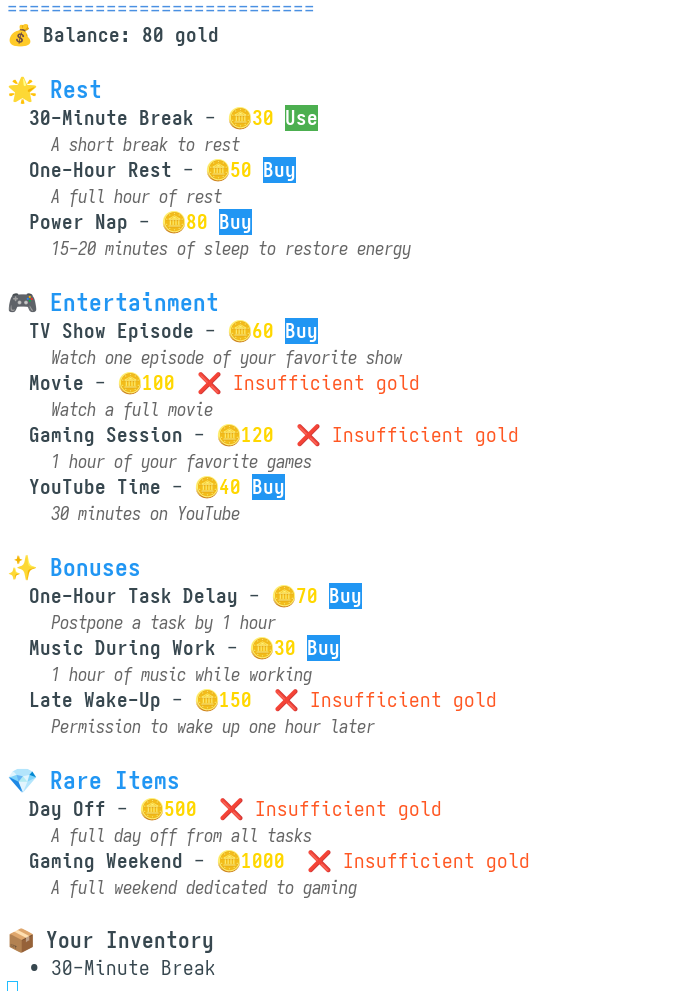

#+TITLE: better-org-habit.el

The package enhances [[https://www.orgmode.org/][Org mode]] habit tracking with a cleaner agenda graph, per-habit streak counting, and a ready-made habit agenda view. It builds on the built-in ~org-habit~ and pairs it with [[https://github.com/ml729/org-habit-stats/][org-habit-stats]] for detailed statistics.

|  |  |  |
/Agenda habit graph, streaks and stats/

* Installation
The package is not yet on MELPA. Install it with ~use-package~ and ~straight~:

#+begin_src emacs-lisp
(use-package better-org-habit
  :straight (better-org-habit :type git :host github :repo "vberezhnev/better-org-habit.el")
  :demand t
  :init
  ;; Org files containing your habits
  (setq better-org-habit-view-files '("~/Org/habits.org")))
#+end_src

Or load the files directly:

#+begin_src emacs-lisp
(load-file "~/path/to/better-org-habit-custom.el")
(load-file "~/path/to/better-org-habit-stats.el")
(load-file "~/path/to/better-org-habit.el")
#+end_src

Mine configuration:
#+begin_src emacs-lisp
(use-package better-org-habit
  :straight (better-org-habit :type git :host github
                              :repo "vberezhnev/better-org-habit.el"
                              :files ("*.el"))
  :after org
  :demand t
  :init
  (setq better-org-habit-view-files '("~/Org/agenda/GTD/org-gtd-habits.org")
        better-org-habit-graph-font-family "Iosevka Nerd Font"
        better-org-habit-view-groups
        '((:name "🌍 Everytime" :tag ("everytime"))
          (:name "🌅 Morning" :tag ("morning"))
          (:name "☀️ Day" :tag ("day"))
          (:name "🌙 Evening" :tag ("evening"))
          (:discard (:anything))
          (:discard (:not (:tag "habit"))))))
#+end_src

* Package layout
The repository ships three files:

- ~better-org-habit.el~ — main integration: agenda faces, glyphs, streak counting, and the automatic habit view.
- ~better-org-habit-custom.el~ — the ~org-habit~ customization group (~M-x customize-group RET org-habit~).
- ~better-org-habit-stats.el~ — the [[https://github.com/ml729/org-habit-stats/][org-habit-stats]] codebase, for detailed habit statistics.

* Defining habits
A habit is any TODO heading with a ~SCHEDULED~ repeater and the ~:STYLE: habit~ property. Example ~~/Org/habits.org~:

#+begin_src org
* Habits

** Morning :morning:

*** TODO Contrast shower
SCHEDULED: <2026-08-01 Sat ++1d>
:PROPERTIES:
:STYLE:    habit
:CATEGORY: PERSONAL
:END:

*** TODO 10k steps
SCHEDULED: <2026-08-01 Sat ++1d>
:PROPERTIES:
:STYLE:    habit
:CATEGORY: CORE
:END:
#+end_src

- ~SCHEDULED~ repeater — ~++1d~ for a daily habit, ~+1w~ / ~+2d~ for every N days, ~.+1d~ to shift from the completion date.
- ~:STYLE: habit~ — this is what makes the heading a habit for ~org-habit~.
- ~:CATEGORY:~ — optional; used by the stats package for grouping.
- ~:LOGBOOK:~ — closing history; ~org-habit~ computes the graph and streaks from it. Enable ~org-log-done~ to record it automatically.

To mark a habit done, use ~org-todo~ (~C-c C-t~) → DONE. With a ~++1d~ repeater the heading reopens itself and the graph advances.

* Usage
** Habit agenda view
When ~better-org-habit-view-files~ is set, the package automatically registers a habit agenda command. Open the agenda dispatch (~C-c a~) and press the view key (default ~x~) to see all habits from those files, grouped by their ~org-super-agenda~ groups (if configured).

The view is customizable:

- ~better-org-habit-view-files~ — org files backing the view (required for the command to appear).
- ~better-org-habit-view-key~ — agenda dispatch key (default ~"x"~).
- ~better-org-habit-view-description~ — dispatch description (default ~"🧘 Habits"~).
- ~better-org-habit-view-span~ — time span, e.g. ~day~ or ~week~ (default ~day~).
- ~better-org-habit-view-prefix-format~ — line prefix format (default ~"  ∘ %t %s"~).
- ~better-org-habit-view-groups~ — ~org-super-agenda~ group spec (default ~nil~).

If you redefine ~org-agenda-custom-commands~ after loading the package, call ~M-x better-org-habit-install-view~ to re-add the command.

Example with grouped view (requires ~org-super-agenda~):

#+begin_src emacs-lisp
(setq better-org-habit-view-files '("~/Org/habits.org")
      better-org-habit-view-groups
      '((:name "🌍 Everytime" :tag ("everytime"))
        (:name "🌅 Morning"   :tag ("morning"))
        (:name "☀️ Day"       :tag ("day"))
        (:name "🌙 Evening"   :tag ("evening"))
        (:discard (:anything))
        (:discard (:not (:tag "habit")))))
#+end_src

Put the matching tags on your habit headings (or on the parent section, from which they are inherited):

#+begin_src org
** Morning :morning:
*** TODO Contrast shower
SCHEDULED: <2026-08-01 Sat ++1d>
:PROPERTIES:
:STYLE:    habit
:END:
#+end_src

** Streaks in the agenda
Each habit line shows its current streak as ~[🔥 N]~, appended on agenda finalization by ~org-habit-streak-count~. Streaks are computed directly from ~org-habit-done-dates~.

** Statistics
~better-org-habit-stats.el~ provides per-habit stats: current and record streaks, completion percentages, monthly/weekly/day bar graphs, and a calendar view. Commands:

| Command                                            | Description                                 |
|----------------------------------------------------+---------------------------------------------|
| ~org-habit-stats-view-next-habit-in-agenda~         | View stats for the next habit in the agenda |
| ~org-habit-stats-view-previous-habit-in-agenda~     | Stats for the previous habit in the agenda  |
| ~org-habit-stats-view-habit-at-point-agenda~        | Stats for the habit at point               |
| ~org-habit-stats-view-next-habit~                   | Next habit in the current buffer           |

Habit properties (like ~:Current_Streak:~ and ~:Habit_Strength:~) are kept up to date via ~org-after-todo-state-change-hook~.

** Keybindings
The package installs the following bindings:

| Keybinding    | Command                                               | Description                                    |
|---------------+-------------------------------------------------------+------------------------------------------------|
| ~<f12>~         | ~toggle-org-habit-show-all-today~                       | Toggle showing all habits on today's agenda   |
| ~Z~ (in agenda) | ~org-habit-stats-view-next-habit-in-agenda~             | View stats for the next habit in the agenda   |
| ~C-c a~ ~x~     | (registered habit agenda view)                          | Open the habit agenda view                    |

* Configuration
** Faces and glyphs
The ~org-habit-*~ faces are set to render the graph cells as squares with a fixed color palette and custom glyphs (~○~, ~◎~, ~●~). The graph spans 14 preceding days (~org-habit-preceding-days~) and 1 following day.

No specific font is required. The graph cells render as squares only with a proportional (non-mono) font; with a monospace default they appear as narrow rectangles. To force a square appearance, set ~better-org-habit-graph-font-family~ to a proportional font of your choice:

#+begin_src emacs-lisp
(setq better-org-habit-graph-font-family "Iosevka Nerd Font")
#+end_src

** Customize group
Run ~M-x customize-group RET org-habit~ to adjust graph column, preceding/following days, glyphs, and face colors.

* Known Issues
- ~org-habit-*~ variables produce "free variable" warnings when byte-compiling the file standalone; they are defined by ~org-habit~ at load time and are not errors.
- With a monospace default font the graph cells render as narrow rectangles; set ~better-org-habit-graph-font-family~ to a proportional font to fix this.
- The stat files originate from [[https://github.com/ml729/org-habit-stats/][org-habit-stats]] and [[https://orgmode.org][Org]]; some internal helpers carry their original names.

* Contributing
Contributions are welcome! Please submit issues or pull requests to [[https://github.com/vberezhnev/better-org-habit.el][the GitHub repository]].
